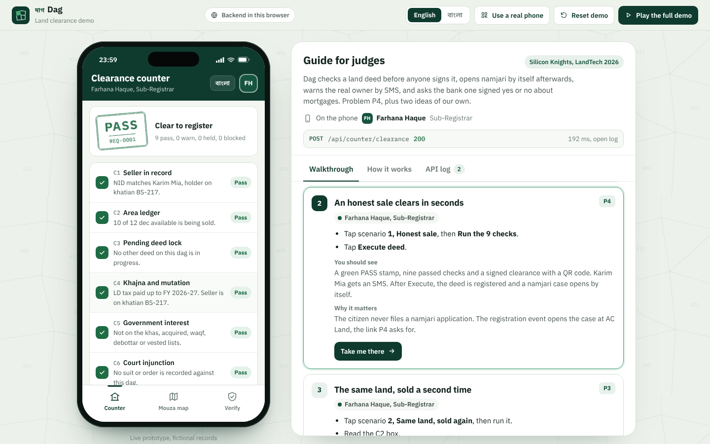

# Dag (দাগ): a clearance gate for land registration

**LandTech 2026. Team Silicon Knights. Problem P4 (Smart e-Mutation and Registry), plus two ideas of our own (P6).**

Dag checks a land deed **before** anyone signs it. The Sub-Registrar enters the dag, the seller, the buyer and the share. Dag runs nine checks and stamps the deed PASS, WARN, HELD or BLOCKED, with every reason and its evidence. A pass produces a signed clearance with a QR code that any phone can verify offline. When the deed is executed, the namjari case opens at AC Land by itself: the citizen files nothing.

Two additions nobody in Bangladesh has shipped:

1. **Owner Lock and Owner Alert.** The real owner gets an SMS, in Bangla and English, the moment a deed or a mortgage touches his dag. If he has locked the dag, nothing goes through until he answers on his own login (up to 48 hours). If he says "not me", it is blocked.
2. **Encumbrance oracle.** The gate asks the bank side one question: is there a live charge on this dag? The answer is a signed yes or no with a date and the lender. The amount and the borrower never leave the bank, so it fits the Bangladesh Bank Order. The same oracle lets a bank's loan desk refuse a second loan on a pledged plot (the job CERSAI does in India).

Around those: a **mouza map** to check before you buy (P5), a **record health scan** that finds land already sold beyond its size, a **printable signed certificate** (P2), a **public verify page** opened by the QR code, and an **autoplay mode** that tells the story with captions.

The whole demo, the phone app and the guide beside it, switches between **English and বাংলা** with one button.

| Counter: a pass, stamped and signed | Owner Lock: the SMS on the owner's own phone |
|---|---|
|  |  |
| **Mouza map: one signed question to the bank** | **Printable signed certificate** |
|  |  |

Concept note: [`docs/Dag_concept_note_SiliconKnights.pdf`](docs/Dag_concept_note_SiliconKnights.pdf). Video script: [`docs/VIDEO_SCRIPT.md`](docs/VIDEO_SCRIPT.md). Deployment: [`DEPLOY.md`](DEPLOY.md).

---

## 1. Run it

No packages, no build step. Node 18+ for the server and tests; any modern browser for the page.

```bash
npm test                    # 34 tests: every scenario, roles, signatures, HTTP
node server/http.js         # http://localhost:8787  (page + API on one port)
python3 -m http.server 5173 # http://localhost:5173  (page only, backend runs in the browser)
```

Live deployment, in this order (full commands in [`DEPLOY.md`](DEPLOY.md)):

1. **GitHub**: push the repo. CI runs the tests on Node 18, 20 and 22.
2. **Render**: New > Blueprint > this repo. `render.yaml` creates `dag-landtech-api` with secret signing seeds. Copy its URL.
3. **`js/config.js`**: set `api: 'https://dag-landtech-api.onrender.com'`, commit, push.
4. **Vercel**: import the repo, framework Other, no build command, output directory `.`.
5. `node scripts/smoke.mjs <render-url> <vercel-url>` checks both ends.

Useful address-bar switches: `?lang=bn` or `?lang=en`, `?autoplay=1`, `?speed=2` (autoplay speed), `?api=browser` or `?api=<url>` (override `js/config.js` for one visit).

## 2. The five demo accounts

All five use the password **`Dag@2026`**. On the login screen, tap an account and its number and password type themselves in. Inside the app, tap the avatar (top right) to switch accounts.

| Account | Phone | Office | Tabs |
|---|---|---|---|
| Farhana Haque, Sub-Registrar | `01000000101` | Kashful Sub-Registry Office | Counter, Mouza map, Verify |
| Karim Mia, Landowner (dags 412 and 418) | `01841255990` | his own phone | My land, Mouza map, Verify |
| Rezaul Islam, AC (Land) | `01000000102` | AC (Land) Office, Kashful | Namjari, Mouza map, Verify |
| Tanvir Ahmed, Bank officer | `01000000103` | Shimul Demo Bank PLC, Kashful branch | Loan desk, Mouza map, Verify |
| Selina Akter, Buyer and owner | `01000000002` | her own phone | Mouza map, My land, Verify |

The server checks the role on every call (401 without a session, 403 with the wrong role), so a landowner cannot reach the counter even with curl. Five wrong passwords lock that number for 60 seconds. Sessions last 12 hours.

**Use a real phone** (top bar) shows a QR code. Scan it with a phone, it opens Karim's account in the same workspace, and the SMS from scenario 4 arrives on that phone. Without a server it opens a second window instead.

## 3. What the judges click

The guide beside the phone has 11 steps, each with a **Take me there** button that logs in the right account and fills the form. Or press **Play the full demo** for a little over two minutes of autoplay with captions in the current language.

| # | Step | Account | Expected result | Problem |
|---|---|---|---|---|
| 1 | Log in | Sub-Registrar | Clearance counter | |
| 2 | Scenario 1, honest sale, then Execute | Sub-Registrar | PASS, signed clearance with QR, SMS to Karim, deed registered, namjari opens by itself | P4 |
| 3 | Scenario 2, same land sold again | Sub-Registrar | BLOCKED on C2: 12 recorded, 10 sold, 2 left, 10 asked, short by 8 | P3 |
| 4 | Scenario 3, acquired land | Sub-Registrar | BLOCKED on C5 (LA case 07/2019) with an appeal number | P5 |
| 5 | Scenario 4, impostor on a locked dag | Sub-Registrar, then Karim | HELD; Karim answers "not me" on his phone; the same request turns BLOCKED | Idea 1 |
| 6 | Scenario 5, hidden mortgage | Sub-Registrar | BLOCKED on C9 from a signed oracle reply | Idea 2 |
| 7 | Loan desk L1, second loan | Bank officer | Do not lend: double financing. Bank side shows what went out and what stayed in | Idea 2 |
| 8 | Scenario 6, tax due and survey gap | Sub-Registrar | WARN; proceed with a note; certificate prints both warnings | P4 |
| 9 | Verify, then tamper test | Bank officer | Signature valid; edited copy INVALID; audit chain intact | P2 |
| 10 | Approve the namjari case | AC (Land) | New khatian for Selina; record health lists dag 449 (18 on 15 decimals) | P4 |
| 11 | Mouza map, plot 425, ask the bank | Buyer | Clean on record, live loan from the oracle | P5 |

Scenario 2 builds on scenario 1. If it is opened first, the counter says so and offers to load scenario 1.

Free play ideas are listed under the steps: the 48-hour notice expiring to a warning, a mortgage on a locked dag (loan desk L2), voiding a clearance by registering a loan before execution, a wrong seller name (C1 warning), and dags 440 (court order), 447 (no namjari) and 449 (over-allocated).

## 4. The nine checks

| Code | Check | Blocks when | Warns when |
|---|---|---|---|
| C1 | Seller in record | the dag does not exist, the NID is unknown, or that person holds nothing on this dag | the name on the deed differs from the NID name |
| C2 | Area ledger | the share asked is more than what is left, or the record already gives out more than the plot has | |
| C3 | Pending deed lock | another deed on this dag is in progress | |
| C4 | Khajna and mutation | the seller is not on a mutation khatian yet (namjari first) | land development tax is overdue |
| C5 | Government interest | khas, acquired, waqf, debottar or vested | |
| C6 | Court injunction | an order stops transfer | |
| C7 | Survey chain | | a link is missing in CS > SA > RS > BS |
| C8 | Owner lock (new) | the owner said "not me" | the 48-hour notice ran out with no answer |
| C9 | Encumbrance oracle (new) | the bank signs "yes, live charge" | |

C8 holds the deed while the owner has not answered. The engine never stops at the first problem, so the officer sees every reason. The worst verdict decides: blocked, then held, then warn, then pass. At **Execute** the checks run once more; if anything changed since the clearance (a new loan, a new deed), the clearance is void.

## 5. How it is built

```
index.html
├── js/client/   the phone app, the judge guide, the API client, English/Bangla strings
├── js/server/   the backend: seed records, rules engine, bank oracle, routes, crypto
├── js/shared/   number and date formatting, QR token format (used by both sides)
└── server/http.js   Node HTTP server around the same backend files
```

One backend, three ways to run it, all from the same files:

| Where | How the page reaches it |
|---|---|
| `node server/http.js` (Render) | the page is served with `<meta name="dag-api" content="http">` and calls `/api/...` on the same origin |
| Vercel page with `js/config.js` pointing at Render | `fetch()` across origins (CORS), with `X-Dag-Workspace` and `Authorization: Bearer` |
| plain static hosting, or Render asleep for 80 s | `Dag.createBackend(browserStore)` runs in the page; records live in localStorage |

`js/client/api.js` is the only door between screens and backend. Every request and response is JSON on both paths, and every call appears in the guide's **API log** tab with the steps inside the gate (the trace), passwords and tokens masked.

**Workspaces.** Each browser gets a random workspace id. The server keeps a separate copy of the records per workspace (up to 300, 24 hours idle), so judges sharing one Render server never see each other's clicks. The **Use a real phone** link carries the workspace id, which is how a second device joins the same records.

**Live updates.** The app polls every 3.5 seconds while logged in: owner alerts arrive as phone notifications, a held request updates by itself when the owner answers, and a held mortgage updates on the loan desk.

### Security, as built

| Concern | What the code does |
|---|---|
| Forged clearances | Ed25519 over canonical JSON. On a server the signing seeds are secret (`DAG_GATE_SEED`, `DAG_ORACLE_SEED`, or generated into `.data/keys.json`). The in-browser backend uses public demo seeds and labels its signatures "demo". |
| QR codes | A compact signed text: clearance id, dag, share, dates, and only the last 4 NID digits. The verify page checks it with the public key on the phone, with no server asked. |
| Passwords | Per-user salt, SHA-512 stretched 4096 times. Never logged; masked in the API log. |
| Guessing | 5 wrong tries lock that phone number for 60 s (HTTP 429). The HTTP server also limits each address to 240 requests and 30 logins a minute. |
| Sessions | Random 128-bit bearer tokens, 12 hours, per workspace. Logout deletes them. |
| Roles | Checked on the server for every route. |
| Input | Dag numbers, NIDs (Bangla digits accepted), shares and names validated with bilingual errors. Request bodies over 100 KB get 413. |
| Tampering with records | Every action goes into a hash chain; the Verify tab shows whether it is intact. |
| Bank secrecy | The oracle discloses only yes/no, the date and the lender. Each reply is logged with what went out and what stayed in. |
| Hosting | `vercel.json` sets a strict Content Security Policy; the Node server sets one too and never serves dotfiles, `server/`, `tests/` or `scripts/`. |

### API

All JSON. Send `Authorization: Bearer <token>` and `X-Dag-Workspace: <id>`. Add `X-Dag-Envelope: 1` to get `{data, trace}`. Errors are `{error, errorBn}`.

| Method and path | Who | What |
|---|---|---|
| `GET /api/health` | anyone | status, key mode |
| `GET /api/keys` | anyone | public keys of the gate and the oracle |
| `GET /api/demo/accounts` | anyone | the five demo accounts |
| `POST /api/auth/login`, `POST /api/auth/logout`, `GET /api/me` | | session |
| `GET /api/counter/presets` | Sub-Registrar | the six scenarios |
| `POST /api/counter/clearance` | Sub-Registrar | run the nine checks on a deed |
| `GET /api/counter/requests/:id` | Sub-Registrar | one request, with live status |
| `POST /api/counter/requests/:id/proceed` | Sub-Registrar | accept a WARN with a note, issue the clearance |
| `POST /api/counter/requests/:id/expire-notice` | Sub-Registrar | demo: let the 48 hours pass |
| `POST /api/counter/requests/:id/execute` | Sub-Registrar | re-check, register, open namjari |
| `GET /api/mouza`, `POST /api/mouza/:no/charge` | any account | map, and one signed oracle question |
| `GET /api/acland/cases`, `POST /api/acland/cases/:id/approve`, `GET /api/acland/reconciliation` | AC (Land) | namjari and record health |
| `GET /api/bank/desk`, `POST /api/bank/check`, `POST /api/bank/charges` | Bank | collateral check, register a mortgage |
| `GET /api/oracle/log` | officers | what the oracle disclosed |
| `GET /api/owner/dags`, `POST /api/owner/dags/:no/lock` | owners | holdings, Owner Lock on or off |
| `GET /api/owner/alerts`, `POST /api/owner/alerts/read-all`, `POST /api/owner/alerts/:id/respond` | owners | SMS inbox, "yes it is me" or "not me" |
| `GET /api/verify/clearances`, `GET /api/verify/:id`, `POST /api/verify/:id/tamper`, `POST /api/verify/token` | officers; token check is public | signatures and QR tokens |
| `GET /api/audit` | officers | the hash chain |
| `POST /api/demo/reset` | any account | fresh records for this workspace |

```bash
# try it against a running server
API=http://localhost:8787
TOKEN=$(curl -s $API/api/auth/login -H 'Content-Type: application/json' -H 'X-Dag-Workspace: ws-curl-test' \
  -d '{"phone":"01000000101","password":"Dag@2026"}' | sed 's/.*"token":"\([^"]*\)".*/\1/')
curl -s $API/api/counter/clearance -H "Authorization: Bearer $TOKEN" -H 'X-Dag-Workspace: ws-curl-test' \
  -H 'Content-Type: application/json' \
  -d '{"dag":"412","share":10,"sellerNid":"9990001001","sellerName":"Karim Mia","buyerNid":"9990001002","buyerName":"Selina Akter"}'
```

### What is real and what is mocked

| Real in this prototype | Mocked, and what replaces it |
|---|---|
| The rules engine, the area arithmetic, the re-check at execution | Land records: a seeded mouza; in production, the e-Khatian and mutation databases |
| Ed25519 signatures, QR tokens, offline verification | NID lookup: seeded persons; in production, the EC NID verification service |
| The audit hash chain | SMS: shown on the phone screen; in production, an SMS gateway |
| Roles, sessions, lockout, workspaces | Bank charges: a seeded register behind the oracle; in production, an interface beside CIB at Bangladesh Bank |
| English and Bangla throughout | Court orders and acquisition lists: seeded; in production, feeds from those offices |

## 6. Language and numbers

Every screen, SMS, error, caption and guide step exists in both languages (356 strings each, checked for parity). The **English / বাংলা** switch in the top bar changes the phone and the guide together; the phone's own button does the same.

In Bangla mode all numbers use Bangla digits: dates (১৭ অক্টোবর ২০২৬), times on Dhaka time, money in lakh grouping (৳১,৫০,০০,০০০), shares as plain numbers (১০ শতাংশ). Names take proper case endings (করিম মিয়ার, সেলিনা আক্তারের, অফিসে). Codes such as `REQ-0001` and signatures stay in Latin letters, as they would on a real form. The fonts are self-hosted: IBM Plex Sans for Latin text and Noto Sans Bengali, whose digits are easy to tell apart (১ and ৯, ৪ and ৮) at small sizes.

## 7. Weaknesses found in v1.1 and fixed in v2

| v1.1 | v2 |
|---|---|
| One demo account held every role; the server did not check roles | Five accounts with their own tabs; roles checked on every route (401/403) |
| Signing keys came from public seeds, so anyone with the code could forge a clearance | Server keys are secret (environment or generated key file); demo keys only in the browser and labelled so |
| Passwords hashed once with one shared salt; no limit on guesses; sessions never expired | Per-user salt, 4096 rounds; lockout after 5 tries; 12-hour sessions; rate limits on the server |
| All visitors of the server shared one set of records | A workspace per browser; the second phone joins by link |
| The QR code carried the full record, including full NIDs | A short signed token with the last 4 NID digits, verified offline on the phone; a public verify page |
| A clearance stayed valid even if a loan was registered before execution | Checks run again at Execute; any change voids the clearance |
| The 48-hour owner notice never ran out | It expires to a warning that requires the officer to record a reason |
| A wrong seller name on the deed went unnoticed | C1 warns when the deed name differs from the NID name |
| A dag that already had more owners than land passed | C2 blocks it; the record health scan lists such dags for AC Land |
| Bangla text mixed with English, digits hard to read (Hind Siliguri), "-এর" glued to names, "১০.০০ শতাংশ" | Full Bangla mode, Noto Sans Bengali, real case endings, plain numbers, lakh grouping |
| Fonts from Google, blocked by the CSP on Vercel and offline | Fonts in `fonts/`, served by both hosts |
| The Vercel page showed errors while Render was asleep | Wake screen with a seconds counter, then automatic fallback to the in-browser backend |
| The trace travelled in an HTTP header that can overflow | `X-Dag-Envelope: 1` returns `{data, trace}` in the body |
| No body limit, unbounded lists in memory | 100 KB limit (413); capped audit, alerts, requests and oracle log |
| Scenario 2 alone showed a PASS and confused judges | The counter says it needs scenario 1 and offers to load it |
| Small guide text; no way to follow on a second device | Larger guide type; **Use a real phone** QR; live polling for SMS and held requests |
| No CI, no way to check a deployment | GitHub Actions on Node 18, 20, 22; `scripts/smoke.mjs` |

## 8. Data used

Every record is invented, as the rules require. Nothing was scraped or downloaded from government sites.

- **People**: made-up names. NIDs all start `999`, a range no real NID uses.
- **Phone numbers**: all start `010`, a prefix no operator in Bangladesh assigns, **except** the landowner login `01841255990`, which is the team leader's own number, used at his request so the demo login is memorable. No SMS is ever sent anywhere: every SMS is drawn on the phone screen.
- **Places**: "Kashful" upazila and "Shapla Nagar" mouza are fictional. Banks are "Kashful Demo Bank PLC" and "Shimul Demo Bank PLC".
- **Facts from the real world** that shaped the design (Telangana's prohibited list errors, CERSAI in India, the Bangladesh Bank Order on CIB secrecy) are cited in the concept note.

## 9. File map

| Path | What it is |
|---|---|
| `index.html` | the page: top bar, phone, guide, certificate, modal, caption |
| `css/dag.css` | the one stylesheet: tokens, phone, guide, certificate, print, responsive |
| `js/config.js` | where the API lives (`'auto'`, `'browser'` or a URL) |
| `js/client/api.js` | API client: backend choice, wake screen, workspace, token, log |
| `js/client/app.js` | the phone app: login, five role views, polling, certificate |
| `js/client/guide.js` | the guide: steps, how it works, API log, autoplay script, second phone |
| `js/client/i18n.js` | all interface strings in English and Bangla |
| `js/client/icons.js` | inline SVG icons |
| `js/shared/format.js` | digits, money, dates on Dhaka time, Bangla case endings |
| `js/shared/qrtoken.js` | the signed QR token format |
| `js/server/seed.js` | accounts, persons, dags, holders, flags, scenarios |
| `js/server/engine.js` | the nine checks |
| `js/server/oracle.js` | the bank oracle and its disclosure log |
| `js/server/crypto.js` | Ed25519, hashing, keys |
| `js/server/server.js` | routes, roles, sessions, alerts, audit chain, stores |
| `server/http.js` | Node HTTP server, workspaces, CORS, limits |
| `tests/gate.test.js` | 34 tests, including real HTTP |
| `scripts/smoke.mjs` | checks a live deployment |
| `render.yaml`, `vercel.json`, `.vercelignore`, `Dockerfile` | hosting |
| `js/vendor/` | TweetNaCl 1.0.3 and qrcode-generator 1.4.4, unmodified |
| `fonts/` | IBM Plex Sans, IBM Plex Mono, Noto Sans Bengali (SIL Open Font License, `fonts/OFL.txt`) |

## 10. Notes for whoever continues this

- Every file in `js/` is a plain script wrapped in a function that attaches to `window.Dag` (or `globalThis.Dag` in Node). There are no modules, no bundler and no framework. The script order in `index.html` matters: vendor, config, shared, server, client.
- The backend is `Dag.createBackend(store).handle(method, path, body, {token, workspace})`. It returns `{status, body, trace}`. Tests call it directly; `server/http.js` and the browser call the same function.
- Add a string: put the key in **both** `STR.en` and `STR.bn` in `js/client/i18n.js`, then use `t('key', {vars})`. Numbers inside strings go through `T.n()`, `T.d()` or `T.money()` so Bangla gets Bangla digits.
- Add a check: add it to `CHECKS` in `engine.js`, return a verdict with `summary` and `summaryBn`, add a test.
- Change records: edit `seed.js` and raise `VERSION`; the browser store key (`dag-demo-state-v5` in `server.js`) should change with it so old browsers start clean.
- Guide steps and the autoplay script are data in `guide.js` (`STEPS`, `SCRIPT`). A step is done when the app emits one of its `done` events (`App.events`).
- Run `npm test` and click through the guide in both languages before pushing. The project's own rule: no em dashes in any text.

## 11. Tools and credits

- **AI assistance**: Claude (Anthropic) helped write code, the Bangla copy and the documentation. The team reviewed, ran and tested all of it and can explain every part.
- **Libraries**: TweetNaCl (public domain), qrcode-generator by Kazuhiko Arase (MIT).
- **Fonts**: IBM Plex Sans and Mono, Noto Sans Bengali (SIL OFL 1.1).
- **Licence**: MIT, see `LICENSE`.

Team Silicon Knights, Daffodil International University.
