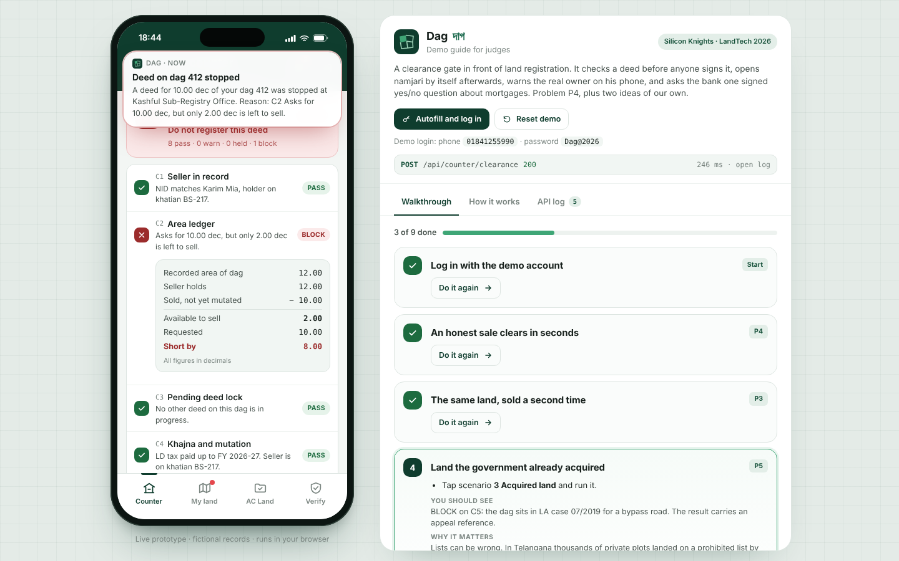
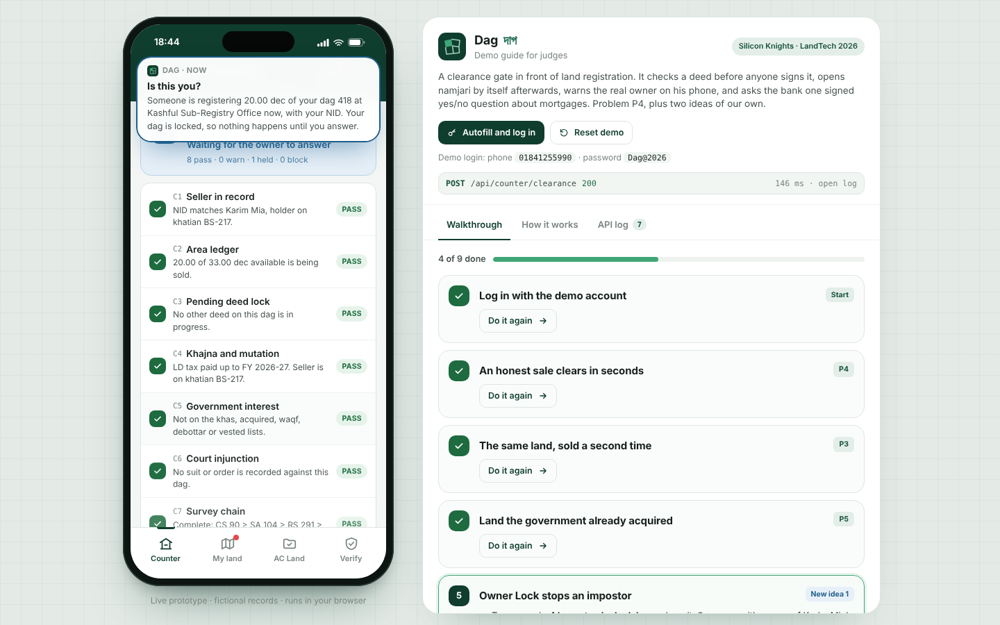

# Dag (দাগ): a clearance gate for land registration

**LandTech 2026 · Team Silicon Knights · Problem P4 (Smart e-Mutation & Registry) plus two ideas of our own (P6)**

Dag checks a land deed **before** anyone signs it. The sub-registrar enters the dag, the seller and the share; Dag runs nine checks and returns PASS, WARN, HELD or BLOCK with every reason and its evidence. A pass produces a signed clearance with a QR code. When the deed is executed, the namjari case opens at AC Land by itself, with no application from the citizen.

Two additions nobody in Bangladesh has shipped yet:

1. **Owner Lock and Owner Alert.** The real owner gets an SMS the moment a deed on his dag reaches a counter. If he has locked the dag, the deed waits for his answer (up to 48 h). If he says "not me", it is blocked.
2. **Encumbrance oracle.** The gate asks the bank side one question: is there a live charge on this dag? The answer is a signed yes/no with a date and the lender. The loan amount and borrower data never leave the bank, so it works within the Bangladesh Bank Order.

The concept note is in [`docs/Dag_concept_note_SiliconKnights.pdf`](docs/).

| Double sale blocked by arithmetic | Owner Lock alert on the phone |
|---|---|
|  |  |

---

## 1. Run it

No build step and no install. Pick one:

| Way | Command | Then open |
|---|---|---|
| Double-click | open `index.html` in Chrome, Edge or Firefox | it runs from the file |
| Python | `python3 -m http.server 5173` | http://localhost:5173 |
| Node | `npx serve .` | the URL it prints |
| Vercel | `npx vercel` in this folder, or import the repo on vercel.com (framework: Other, no build command) | the Vercel URL |
| GitHub Pages | Settings > Pages > deploy from branch `main`, folder `/` | the Pages URL |

Fonts load from Google Fonts. Offline, the page falls back to system fonts and still works.

### Demo login

| Phone | Password |
|---|---|
| `01841255990` | `Dag@2026` |

Press **Autofill and log in** in the guide (or **Use demo account** on the phone) and both fields type themselves in. The login is defined in two lines at the top of [`js/server/seed.js`](js/server/seed.js) (`DEMO_PHONE`, `DEMO_PASSWORD`).

### Tests

```bash
node --test tests/gate.test.js     # or: npm test
```

13 tests walk every scenario through the same code the browser runs: login, honest sale, double sale (with and without executing the first deed), acquired land, owner lock (both answers), hidden mortgage (and that the loan amount never leaks), the warning path, free-play cases, signature verify and tamper, a deliberately broken audit chain, AC Land approval and lock toggling.

---

## 2. The judge's walkthrough

The page shows a phone on the left and a guide on the right. Each guide step has a **Take me there** button that moves the phone to the right screen and fills the form; the judge presses the main button. Progress is tracked (x of 9 done) and the **API log** tab shows every call live.

| # | Scenario | What happens | Problem |
|---|---|---|---|
| 1 | Honest sale, dag 412, 10 of 12 dec | PASS 9/9, signed clearance + QR, owner alerted. Execute: deed registered, namjari opened automatically | P4 |
| 2 | Same land, sold again | BLOCK C2: area 12.00, already sold 10.00, available 2.00, asked 10.00, **short by 8.00**. If step 1 was not executed, C3 blocks instead | P3 |
| 3 | Acquired land, dag 431 | BLOCK C5: LA case 07/2019, with an appeal reference | P5 |
| 4 | Impostor on locked dag 418 | HELD, push to the owner's phone. Owner taps "No, not me": BLOCK | New 1 |
| 5 | Hidden mortgage, dag 425 | BLOCK C9: live charge since 12 Mar 2024. Bank side shows what was disclosed and what was withheld | New 2 |
| 6 | Tax due, survey gap, dag 433 | WARN (3 years LD tax, no RS dag). Officer writes a note, clearance issued with both warnings printed | P4 |
| 7 | Verify | Valid Ed25519 signature. Tamper test (+2 dec, same signature): INVALID. Audit chain intact | P2 |
| 8 | AC Land | Approve: new khatian for the buyer; owner now holds 2.00 dec | P4 |

Free play: dag `440` with seller NID `9990001011` (court injunction, C6), dag `447` with `9990001012` (seller never did namjari, C4), dag `999` (does not exist).

**Reset demo** puts every record back to the start.

---

## 3. How it works

```
 Phone app (4 roles)          JSON boundary              Dag gate (js/server)                Mocked outside systems
 ┌─────────────────┐   POST /api/counter/clearance   ┌──────────────────────────┐        ┌──────────────────────┐
 │ Counter         │ ──────────────────────────────▶ │ server.js   router, state │ ─────▶ │ NID service          │
 │ My land (owner) │ ◀────────────────────────────── │ engine.js   C1..C9 (pure) │ ─────▶ │ CIB oracle (own key) │
 │ AC Land         │   { request, checks, trace }    │ crypto.js   Ed25519, hash │ ─────▶ │ SMS gateway          │
 │ Verify          │                                 │ oracle.js   bank side     │ ─────▶ │ AC Land namjari      │
 └─────────────────┘     js/client/api.js            │ seed.js     fictional data│        └──────────────────────┘
                                                     └──────────────────────────┘
```

### One clearance request, step by step

1. The counter posts the deed to `POST /api/counter/clearance`.
2. NID lookup (mock) resolves the seller.
3. The CIB oracle (mock) is asked about a live charge and signs its reply; the gate verifies that signature.
4. The rules engine runs **all nine checks**. It never stops at the first failure, so the officer sees every reason.
5. The worst single check decides: BLOCK > HELD > WARN > PASS.
6. Subscribed owners get an SMS (mock). On a locked dag the owner's answer feeds back into C8 and the checks run again.
7. On PASS the gate signs a clearance (Ed25519 over canonical JSON) and shows it with a QR code.
8. Every step is appended to a SHA-512 hash chain.
9. On execute: the deed is registered, the area ledger records the share as sold (not yet mutated), and a namjari case opens at AC Land.

The response includes a `trace` array of these internal steps. The guide's API log shows it under "Inside the gate".

### The nine checks (`js/server/engine.js`)

| Code | Check | Result |
|---|---|---|
| C1 | Seller in record | BLOCK if the seller's NID is not a holder on the khatian |
| C2 | Area ledger | BLOCK if requested share > holder's share minus shares sold but not yet mutated |
| C3 | Pending deed lock | BLOCK if another clearance on the dag is open (24 h validity) |
| C4 | Khajna and mutation | BLOCK if the seller has no mutation khatian; WARN if LD tax is behind |
| C5 | Government interest | BLOCK if on the khas, acquired, waqf, debottar or vested lists |
| C6 | Court injunction | BLOCK if a suit or order is recorded |
| C7 | Survey chain | WARN if CS, SA, RS, BS do not all map |
| C8 | Owner lock (new) | HELD until the owner answers; BLOCK on "not me"; PASS on "me" |
| C9 | Encumbrance oracle (new) | BLOCK on a live charge or a bad oracle signature |

### Security

- **Clearances** are signed with Ed25519 over sorted-key JSON. Any edit breaks verification. Verification is public: banks, buyers and AC Land can check without logging in.
- **Audit log** entries each hold the SHA-512 hash of the previous entry.
- **The oracle** discloses one bit plus a date and the lender, never the amount, reference or the borrower's other loans.
- **Passwords** are stored as salted hashes and masked in the API log. Officers see owners' phones masked (018•••••990).
- Demo signing keys are derived from fixed seeds (so a clearance still verifies after reload). Production keys belong in an HSM.

### What is real and what is mocked

| Part | Status |
|---|---|
| Rules engine, area ledger, lock flow, namjari event | Real logic, covered by tests |
| Ed25519 signatures, SHA-512 audit chain | Real cryptography (TweetNaCl) |
| NID service, CIB oracle, SMS gateway | Mocks behind the same call shape a real service would have |
| Land records | Invented: one fictional mouza (Shapla Nagar, JL 112), 7 dags, 12 people |

### Where the backend runs, and why

In this build the gate's backend (`js/server/*`) runs in the browser. The screens never call it directly: every request goes through `js/client/api.js`, which serialises the body to JSON, calls `Dag.server.handle(method, path, body, token)`, serialises the response, and logs both. This gives judges one static link with no server to wake up, and the API log shows exactly what would cross the wire. State is kept in `localStorage`, so a reload keeps progress; **Reset demo** clears it.

To move the backend to a real server: run the same `js/server` files in Node behind Express or Fastify (they already load in Node, see the tests), and in `api.js` replace the `Dag.server.handle(...)` line with a `fetch`. No screen code changes.

---

## 4. Project structure

```
index.html              page shell: phone frame + guide panel, script order
css/dag.css             the single theme for app and guide (tokens at the top)
js/vendor/              tweetnacl (Ed25519, SHA-512), qrcode-generator
js/server/crypto.js     canonical JSON, sign/verify, hash, demo keys
js/server/seed.js       fictional records, scenarios, the demo login
js/server/engine.js     the nine checks. Pure functions. Read this first.
js/server/oracle.js     mock CIB charge oracle with its own key
js/server/server.js     API router, state, audit chain, alerts, namjari event
js/client/api.js        the JSON boundary + API log
js/client/icons.js      inline SVG icons and the Dag mark
js/client/app.js        the phone app (4 tabs); exposes window.DagApp for the guide
js/client/guide.js      walkthrough, how it works, live API log
tests/gate.test.js      13 scenario tests (node --test)
docs/                   concept note PDF, screenshots
```

## 5. API reference

All paths are under `/api`. Send the token from login as the session. Errors return `{ "error": "..." }` with 400, 401, 403, 404 or 409.

| Method | Path | Auth | Does |
|---|---|---|---|
| POST | `/auth/login` | no | `{phone, password}` > `{token, user}` |
| GET | `/me` | yes | current user |
| POST | `/auth/logout` | yes | ends the session |
| GET | `/counter/presets` | yes | office, mouza, the six scenarios |
| POST | `/counter/clearance` | yes | `{dag, sellerNid, sellerName, buyerName, buyerNid, share}` > `{request, alertsSent}` |
| GET | `/counter/requests/:id` | yes | latest state of a request |
| POST | `/counter/requests/:id/proceed` | yes | `{note}` (8+ chars) on a WARN > signed clearance with warnings |
| POST | `/counter/requests/:id/execute` | yes | registers the deed, opens namjari > `{request, deed, case, alertsSent}` |
| GET | `/acland/cases` | yes | namjari queue |
| POST | `/acland/cases/:id/approve` | yes | corrects holders, opens a new khatian |
| GET | `/owner/dags` | yes | the user's dags, lock state, transfers |
| POST | `/owner/dags/:no/lock` | yes | `{on}` |
| GET | `/owner/alerts` | yes | `{unread, alerts}` |
| POST | `/owner/alerts/read-all` | yes | marks informational alerts read |
| POST | `/owner/alerts/:id/respond` | yes | `{answer: "me" or "not_me"}`, re-runs the checks |
| GET | `/verify/clearances` | yes | list of clearances |
| GET | `/verify/:id` | no | `{valid, payload, signature, keyId}` |
| POST | `/verify/:id/tamper` | no | verifies an edited copy (demo) > `{valid: false}` |
| GET | `/keys` | no | public key fingerprints |
| GET | `/oracle/log` | yes | the bank side's view: disclosed vs withheld |
| GET | `/audit` | yes | `{count, intact, head, entries}` |
| POST | `/demo/reset` | no | reseeds every record, keeps the session |

## 6. Data used

All data is invented and lives in `js/server/seed.js`. No real names, NIDs, land records or government data are used, and nothing is scraped. NIDs start with `999`. The mouza, upazila, banks, court and company names are fictional.

| Dag | Area | Holder | Set up to show |
|---|---|---|---|
| 412 | 12 | Karim Mia (demo owner) | honest sale, then double sale |
| 418 | 33 | Karim Mia, **locked** | impostor stopped by Owner Lock |
| 425 | 9.5 | Green Acre Properties Ltd | hidden mortgage (bank side) |
| 431 | 16 | Nurul Islam | acquired for a road |
| 433 | 40 | Mokbul Hossain | LD tax 3 years due, no RS dag |
| 440 | 25 | Ayesha Siddiqua | court status quo order |
| 447 | 20 | Hasan Ali | inherited, namjari never done |

The one exception to "all invented" is the demo login phone number, which belongs to the team leader and was used at his request. To replace it, change `DEMO_PHONE` in `js/server/seed.js`.

## 7. AI tools used

- **Claude (Anthropic)** was used to research precedents (Karnataka Bhoomi and Kaveri, Punjab LRMIS, Telangana Dharani, CERSAI, US county property fraud alerts), to draft the concept note and diagrams, and to generate most of the code in this repository, including the tests.
- The team reviewed every file, ran the tests and the walkthrough, and can explain each check in `engine.js` and each route in `server.js`.

## 8. Continuing the build (notes for the next developer or AI)

**Conventions**
- Plain browser JavaScript, no framework, no build. Every file is an IIFE that attaches to the `Dag` namespace and works in both the browser and Node.
- Server files never touch the DOM. Client files never touch `state`; they only use `Dag.api`.
- Screens are pure functions of the state object `S` in `app.js`: action > API call > update `S` > `render()`. Buttons use `data-action` attributes handled in one `onClick` switch.
- All copy is plain English in short sentences. Money and shares use 2 decimals (`f2`). Do not use real people or records.
- Theme tokens are at the top of `css/dag.css`. Verdict colours: pass green, warn amber, hold blue (also used for the two new ideas), block red.

**How to add a check**
1. Add `{ code: 'C10', name: '...' }` to `CHECKS` in `engine.js` and write its block inside `evaluate()` using `add(code, verdict, summary, evidence)`.
2. Pass any new data in through the `evaluate({...})` call in `server.js > runChecks()`.
3. Add a test in `tests/gate.test.js`. Add a row to the checks tables in `guide.js` (How it works) and in this README.

**How to add a scenario**
Add an entry to `PRESETS` in `seed.js` and any records it needs, bump `VERSION` in `seed.js` (old browser state is then discarded), and add a step to `STEPS` in `guide.js` with a `done` event. Events are emitted in `app.js` as `s<presetId>.<verdict>`, `s<presetId>.exec`, `s<presetId>.issued`, `owner.me`, `owner.not_me`, `verify.tamper` and `acland.approve`.

**Sensible next steps**
- Move `js/server` behind a Node HTTP server with PostgreSQL; keep the route table unchanged.
- Bangla interface strings (the theme already loads Hind Siliguri).
- A 48 h expiry job for held requests, and an appeal workflow screen at AC Land.
- Read the CS/SA/RS/BS chain from digitised khatians (P1) instead of seed data.

## 9. Changes after Round 1

_Required for the final round: list every change made after the Round 1 submission here._

## Team

| Role | Name |
|---|---|
| Team leader | Tammam Ibn Aman (CSE, DIU) |
| Member | _add name_ |
| Faculty mentor | Tamanna Sultana, Lecturer, Dept. of CSE, DIU |
| Industry mentor | MD Zafor Iqbal, CSE-TECH |

Code under the MIT licence. See [LICENSE](LICENSE).
