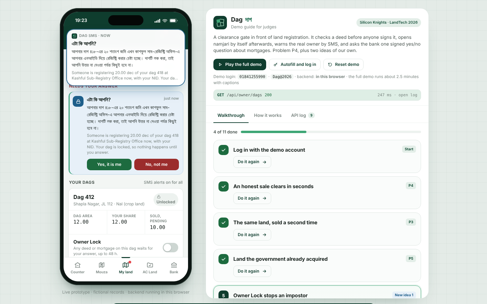
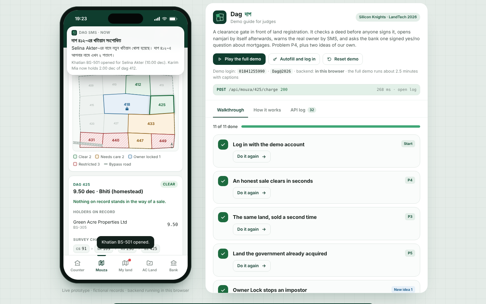
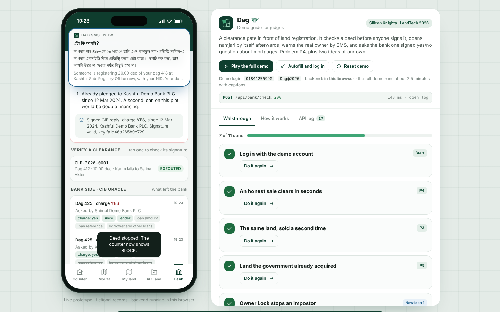
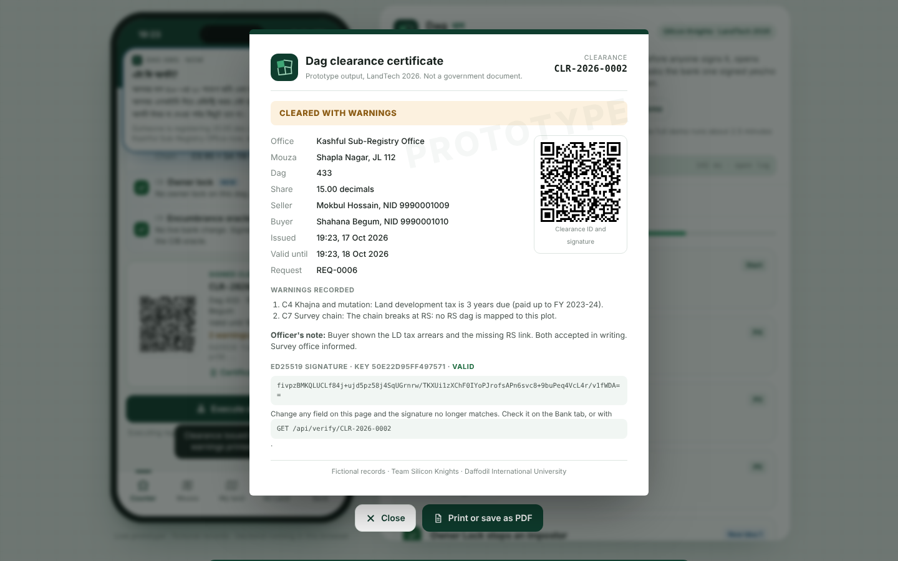

# Dag (দাগ): a clearance gate for land registration

**LandTech 2026 · Team Silicon Knights · Problem P4 (Smart e-Mutation & Registry) plus two ideas of our own (P6)**

Dag checks a land deed **before** anyone signs it. The sub-registrar enters the dag, the seller and the share; Dag runs nine checks and returns PASS, WARN, HELD or BLOCK with every reason and its evidence. A pass produces a signed clearance with a QR code. When the deed is executed, the namjari case opens at AC Land by itself, with no application from the citizen.

Two additions nobody in Bangladesh has shipped yet:

1. **Owner Lock and Owner Alert.** The real owner gets an SMS, in Bangla, the moment a deed or a mortgage touches his dag. If he has locked the dag, nothing goes through until he answers (up to 48 h). If he says "not me", it is blocked.
2. **Encumbrance oracle.** The gate asks the bank side one question: is there a live charge on this dag? The answer is a signed yes/no with a date and the lender. The loan amount and borrower data never leave the bank, so it works within the Bangladesh Bank Order. The same oracle lets a bank's loan desk refuse a second loan on a pledged plot.

Around those, the demo also has a **mouza map** (check before you buy, P5), a **record health scan** that finds land sold more times than it exists, a **printable signed certificate** (P2), and an **autoplay mode** that tells the whole story with captions.

The concept note is [`docs/Dag_concept_note_SiliconKnights.pdf`](docs/). The video script is [`docs/VIDEO_SCRIPT.md`](docs/VIDEO_SCRIPT.md).

| Owner Lock: Bangla SMS to the real owner | Mouza map: check before you buy |
|---|---|
|  |  |
| **Loan desk: double financing refused** | **Printable signed certificate** |
|  |  |

---

## 1. Run it

Nothing to install, no build step. Two ways to run the same backend:

### A. Static (the backend runs in the browser)

| Way | Command | Open |
|---|---|---|
| Double-click | open `index.html` in Chrome, Edge or Firefox | runs from the file |
| Python | `python3 -m http.server 5173` (or `npm start`) | http://localhost:5173 |
| Vercel | import the repo on vercel.com, framework **Other**, no build command | the Vercel URL |
| GitHub Pages | Settings > Pages > deploy from branch `main`, folder `/` | the Pages URL |

Best for the public demo link: there is no server to fall asleep while a judge waits.

### B. Real HTTP server (Node 18+, no dependencies)

```bash
node server/http.js          # or: npm run serve
# Dag is running at http://localhost:8787   (API base: /api)
```

The page is served with `<meta name="dag-api" content="http">`, so the phone app calls the server with `fetch()`. State is saved to `.data/store.json`. Deploys as-is to Render, Railway or any Node host (`PORT` is respected).

```bash
# try the API directly
TOKEN=$(curl -s localhost:8787/api/auth/login -H 'Content-Type: application/json' \
  -d '{"phone":"01841255990","password":"Dag@2026"}' | sed 's/.*"token":"\([^"]*\)".*/\1/')
curl -s localhost:8787/api/counter/clearance -H "Authorization: Bearer $TOKEN" -H 'Content-Type: application/json' \
  -d '{"dag":"412","sellerNid":"9990001001","sellerName":"Karim Mia","buyerName":"Selina Akter","buyerNid":"9990001002","share":10}'
```

Each API response carries an `X-Dag-Trace` header listing the steps inside the gate.

### Demo login

| Phone | Password |
|---|---|
| `01841255990` | `Dag@2026` |

Press **Autofill and log in** in the guide (or **Use demo account** on the phone) and both fields type themselves in. The login is set in two lines at the top of [`js/server/seed.js`](js/server/seed.js).

### Tests

```bash
node --test tests/gate.test.js     # or: npm test
```

20 tests walk every scenario through the same code the browser runs, including one that boots `server/http.js` and talks to it over real HTTP.

---

## 2. The demo page

A phone on the left, a guide on the right. The guide has three tabs:

- **Walkthrough**: 11 steps. Each has a **Take me there** button that moves the phone to the right screen and fills the form; the judge presses the main button. Progress shows as x of 11 done.
- **How it works**: request lifecycle, architecture diagram, the nine checks, security, what is real and what is mocked.
- **API log**: every call live, with the request, the steps inside the gate, and the response. Passwords and tokens are masked.

**Play the full demo** runs the whole story by itself in about 2 minutes 20 seconds, with captions and a progress bar. Start a screen recorder, press it, and the Round 1 video records itself. `?speed=2` plays it faster; `?autoplay=1` starts it on load.

| # | Step | What happens | Problem |
|---|---|---|---|
| 1 | Log in | Autofill types the demo phone and password | |
| 2 | Honest sale, dag 412, 10 of 12 dec | PASS 9/9, signed clearance + QR, Bangla SMS to the owner. Execute: deed registered, namjari opens by itself | P4 |
| 3 | Same land, sold again | BLOCK C2: area 12.00, already sold 10.00, available 2.00, asked 10.00, **short by 8.00** | P3 |
| 4 | Acquired land, dag 431 | BLOCK C5: LA case 07/2019, with an appeal reference | P5 |
| 5 | Impostor on locked dag 418 | HELD, SMS to the owner. He taps "No, not me": BLOCK | New 1 |
| 6 | Hidden mortgage, dag 425 | BLOCK C9: live charge since 12 Mar 2024, signed oracle reply | New 2 |
| 7 | Loan desk, second loan on 425 | Refused: double financing. Bank side shows what was disclosed and what was withheld | New 2 |
| 8 | Tax due, survey gap, dag 433 | WARN. Officer's note, clearance signed with both warnings, printable certificate | P4 |
| 9 | Verify and tamper | Valid Ed25519 signature; edited copy INVALID; audit chain intact | P2 |
| 10 | AC Land | Approve: new khatian for the buyer. Record health lists dag 449, sold beyond its size | P4 |
| 11 | Mouza map | Dag 425 looks clean on the record; one signed question to the bank shows the loan | P5 |

Free play: loan scenario **L2** (a mortgage on Karim's locked dag waits for his answer), dag `449` with seller NID `9990001013` (over-allocated record), `440` with `9990001011` (court injunction), `447` with `9990001012` (no namjari), `999` (no such dag). **Reset demo** puts every record back to the start.

---

## 3. How it works

```
 Phone app (5 roles)            JSON boundary                 Dag gate (js/server)                Mocked outside systems
 ┌──────────────────┐   POST /api/counter/clearance   ┌───────────────────────────┐        ┌──────────────────────┐
 │ Counter          │ ──────────────────────────────▶ │ server.js   router, state  │ ─────▶ │ NID service          │
 │ Mouza (map)      │ ◀────────────────────────────── │ engine.js   C1..C9 (pure)  │ ─────▶ │ CIB oracle (own key) │
 │ My land (owner)  │   { request, checks } + trace   │ crypto.js   Ed25519, hash  │ ─────▶ │ SMS gateway          │
 │ AC Land          │                                 │ oracle.js   bank side      │ ─────▶ │ AC Land namjari      │
 │ Bank             │   js/client/api.js              │ seed.js     fictional data │        └──────────────────────┘
 └──────────────────┘   (in-browser or fetch)         └───────────────────────────┘
                                                        server/http.js: same files behind Node HTTP
```

### One clearance request, step by step

1. The counter posts the deed to `POST /api/counter/clearance`.
2. NID lookup (mock) resolves the seller.
3. The CIB oracle (mock) is asked about a live charge and signs its reply; the gate verifies that signature.
4. The rules engine runs **all nine checks**. It never stops at the first failure, so the officer sees every reason.
5. The worst single check decides: BLOCK > HELD > WARN > PASS.
6. Subscribed owners get an SMS in Bangla and English (mock). On a locked dag the owner's answer feeds back into C8 and the checks run again.
7. On PASS the gate signs a clearance (Ed25519 over canonical JSON) and shows it with a QR code.
8. Every step is appended to a SHA-512 hash chain.
9. On execute: the deed is registered, the area ledger records the share as sold (not yet mutated), and a namjari case opens at AC Land.

### The nine checks (`js/server/engine.js`)

| Code | Check | Result |
|---|---|---|
| C1 | Seller in record | BLOCK if the seller's NID is not a holder on the khatian |
| C2 | Area ledger | BLOCK if the share asked > holder's share minus shares sold but not yet mutated; BLOCK if the record already gives out more land than the dag holds |
| C3 | Pending deed lock | BLOCK if another clearance on the dag is open (24 h validity) |
| C4 | Khajna and mutation | BLOCK if the seller has no mutation khatian; WARN if LD tax is behind |
| C5 | Government interest | BLOCK if on the khas, acquired, waqf, debottar or vested lists |
| C6 | Court injunction | BLOCK if a suit or order is recorded |
| C7 | Survey chain | WARN if CS, SA, RS, BS do not all map |
| C8 | Owner lock (new) | HELD until the owner answers; BLOCK on "not me"; PASS on "me" |
| C9 | Encumbrance oracle (new) | BLOCK on a live charge or a bad oracle signature |

### Beyond the counter

- **Mouza map** (`GET /api/mouza`). Plots coloured from the record only: clear, needs care, owner locked, restricted. Tapping a plot shows holders, the survey chain and reasons. The bank is asked only when the user presses the button (`POST /api/mouza/:no/charge`), one dag at a time.
- **Loan desk** (`POST /api/bank/check`, `POST /api/bank/charges`). Collateral check through the same oracle. A pledged plot is refused. A mortgage on a locked dag is held for the owner's answer, like a deed.
- **Record health** (`GET /api/acland/reconciliation`). Scans every dag on onboarding: over-allocation, holders without namjari, survey gaps, unpaid tax, sales awaiting namjari.

### Security

- **Clearances** are signed with Ed25519 over sorted-key JSON. Any edit breaks verification. Verification is public.
- **Audit log** entries each hold the SHA-512 hash of the previous entry.
- **The oracle** discloses one bit plus a date and the lender, never the amount, reference or the borrower's other loans.
- **Passwords** are stored as salted hashes and masked in the API log. Officers see owners' phones masked (018•••••990).
- **The HTTP server** never serves dotfiles (`.git`, `.data`) or its own source.
- Demo signing keys come from fixed seeds so a clearance still verifies after a reload. Production keys belong in an HSM.

### What is real and what is mocked

| Part | Status |
|---|---|
| Rules engine, area ledger, locks, namjari event, record health | Real logic, covered by tests |
| Ed25519 signatures, SHA-512 audit chain | Real cryptography (TweetNaCl) |
| HTTP API | Real (`server/http.js`), or in-browser for the static link |
| NID service, CIB oracle, SMS gateway | Mocks with the call shape a real service would have |
| Land records | Invented: one fictional mouza (Shapla Nagar, JL 112), 8 dags, 14 people, 2 demo banks |

---

## 4. Project structure

```
index.html              page shell: phone frame, guide, certificate and caption hosts
css/dag.css             one theme for app, guide, certificate and print (tokens at the top)
js/vendor/              tweetnacl (Ed25519, SHA-512), qrcode-generator
js/server/crypto.js     canonical JSON, sign/verify, hash, demo keys
js/server/seed.js       fictional records, map geometry, scenarios, the demo login
js/server/engine.js     the nine checks. Pure functions. Read this first.
js/server/oracle.js     mock CIB charge oracle with its own key
js/server/server.js     API router, state, audit chain, Bangla SMS, map, loan desk, record health
server/http.js          the same backend behind a real Node HTTP server
js/client/api.js        the JSON boundary (in-browser or fetch) + API log
js/client/icons.js      inline SVG icons and the Dag mark
js/client/app.js        the phone app (5 tabs) and the certificate; exposes window.DagApp
js/client/guide.js      walkthrough, how it works, API log, autoplay with captions
tests/gate.test.js      20 tests (node --test)
docs/                   concept note PDF, video script, screenshots
```

## 5. API reference

All paths are under `/api`. Send the token from login as `Authorization: Bearer <token>` (HTTP mode). Errors return `{ "error": "..." }` with 400, 401, 403, 404 or 409.

| Method | Path | Auth | Does |
|---|---|---|---|
| POST | `/auth/login` | no | `{phone, password}` > `{token, user}` |
| GET | `/me` | yes | current user |
| POST | `/auth/logout` | yes | ends the session |
| GET | `/health` | no | liveness |
| GET | `/counter/presets` | yes | office, mouza, the six scenarios |
| POST | `/counter/clearance` | yes | `{dag, sellerNid, sellerName, buyerName, buyerNid, share}` > `{request, alertsSent}` |
| GET | `/counter/requests/:id` | yes | latest state of a request |
| POST | `/counter/requests/:id/proceed` | yes | `{note}` (8+ chars) on a WARN > signed clearance with warnings |
| POST | `/counter/requests/:id/execute` | yes | registers the deed, opens namjari |
| GET | `/mouza` | yes | every dag with status, reasons, holders, map polygon |
| POST | `/mouza/:no/charge` | yes | one signed oracle question for one dag |
| GET | `/acland/cases` | yes | namjari queue |
| POST | `/acland/cases/:id/approve` | yes | corrects holders, opens a new khatian |
| GET | `/acland/reconciliation` | yes | record health for the mouza |
| GET | `/bank/desk` | yes | loan desk, scenarios, charges this bank registered |
| POST | `/bank/check` | yes | `{dag, borrowerNid}` > `{outcome: ok or refuse, reasons, oracle}` |
| POST | `/bank/charges` | yes | `{dag, borrowerNid, amount}` > charge `live`, or `held` for the owner |
| GET | `/owner/dags` | yes | the user's dags, lock state, transfers, mortgages |
| POST | `/owner/dags/:no/lock` | yes | `{on}` |
| GET | `/owner/alerts` | yes | `{unread, alerts}` (Bangla and English) |
| POST | `/owner/alerts/read-all` | yes | marks informational alerts read |
| POST | `/owner/alerts/:id/respond` | yes | `{answer: "me" or "not_me"}` for a deed or a mortgage |
| GET | `/verify/clearances` | yes | list of clearances |
| GET | `/verify/:id` | no | `{valid, payload, signature, keyId}` |
| POST | `/verify/:id/tamper` | no | verifies an edited copy (demo) > `{valid: false}` |
| GET | `/keys` | no | public key fingerprints |
| GET | `/oracle/log` | yes | the bank side's view: disclosed vs withheld |
| GET | `/audit` | yes | `{count, intact, head, entries}` |
| POST | `/demo/reset` | no | reseeds every record, keeps the session |

## 6. Data used

All data is invented and lives in `js/server/seed.js`. No real names, NIDs, land records or government data are used, and nothing is scraped. NIDs start with `999`. The mouza, upazila, banks, court and company names are fictional.

| Dag | Area | Holder | Set up to show |
|---|---|---|---|
| 412 | 12 | Karim Mia (demo owner) | honest sale, then double sale |
| 418 | 33 | Karim Mia, **locked** | impostor stopped; mortgage held for the owner |
| 425 | 9.5 | Green Acre Properties Ltd | hidden mortgage at Kashful Demo Bank |
| 431 | 16 | Nurul Islam | acquired for a road |
| 433 | 40 | Mokbul Hossain | LD tax 3 years due, no RS dag |
| 440 | 25 | Ayesha Siddiqua | court status quo order |
| 447 | 20 | Hasan Ali | inherited, namjari never done |
| 449 | 15 | Joynal Abedin 10 + Rokeya Khatun 8 | sold beyond its size before Dag |

The one exception to "all invented" is the demo login phone number, which belongs to the team leader and was used at his request. To replace it, change `DEMO_PHONE` in `js/server/seed.js`.

## 7. AI tools used

- **Claude (Anthropic)** was used to research precedents (Karnataka Bhoomi and Kaveri, Punjab LRMIS, Telangana Dharani, CERSAI, US county property fraud alerts), to draft the concept note and diagrams, and to generate most of the code in this repository, including the tests.
- The team reviewed every file, ran the tests and the walkthrough, and can explain each check in `engine.js` and each route in `server.js`.

## 8. Continuing the build (notes for the next developer or AI)

**Conventions**
- Plain JavaScript, no framework, no build. Every file under `js/` is an IIFE that attaches to the `Dag` namespace and runs in both the browser and Node.
- Server files never touch the DOM. Client files never touch `state`; they only use `Dag.api`.
- Screens are pure functions of the state object `S` in `app.js`: action > API call > update `S` > `render()`. Buttons use `data-action` attributes handled in one `onClick` switch.
- Copy is plain English in short sentences, and no em dashes. SMS text is written twice, `text` and `textBn`, with Bangla digits in `textBn`. Shares use 2 decimals (`f2`). Never use real people or records.
- Theme tokens are at the top of `css/dag.css`. Verdict colours: pass green, warn amber, hold blue (also the colour of the two new ideas), block red.

**How to add a check**
1. Add `{ code: 'C10', name: '...' }` to `CHECKS` in `engine.js` and write its block inside `evaluate()` using `add(code, verdict, summary, evidence)`.
2. Pass any new data in through `evaluate({...})` in `server.js > runChecks()`. Add a Bangla reason to `CHECK_BN`.
3. Add a test in `tests/gate.test.js`, and a row to the checks tables in `guide.js` (How it works) and this README.

**How to add a scenario**
Add an entry to `PRESETS` in `seed.js` and any records it needs, bump `VERSION` in `seed.js` (old browser state is then discarded), and add a step to `STEPS` in `guide.js` with a `done` event. Events are emitted in `app.js` as `s<presetId>.<verdict>`, `s<presetId>.exec`, `s<presetId>.issued`, `owner.me`, `owner.not_me`, `loan<presetId>.<outcome or status>`, `mortgage.me`, `mortgage.not_me`, `verify.tamper`, `acland.approve`, `mouza.pick`, `mouza.ask` and `cert.open`. To include it in the video, add a scene to `SCRIPT` in `guide.js`.

**Sensible next steps**
- Put PostgreSQL behind `server/http.js` in place of the JSON file; the route table stays the same.
- A full Bangla interface (the font is loaded and SMS is already bilingual).
- A 48 h expiry job for held requests, and an appeal screen at AC Land.
- Read the CS/SA/RS/BS chain from digitised khatians (P1) instead of seed data.

## 9. Changes after Round 1

_Required for the final round: list every change made after the Round 1 submission here._

## Team

| Role | Name |
|---|---|
| Team leader | Tammam Ibn Aman (CSE, DIU) |
| Member | _add name_ |
| Faculty mentor | Tamanna Sultana, Lecturer, Dept. of CSE, DIU |
| Industry mentor | MD Zafor Iqbal, CSE-TECH |

Code under the MIT licence. See [LICENSE](LICENSE).
